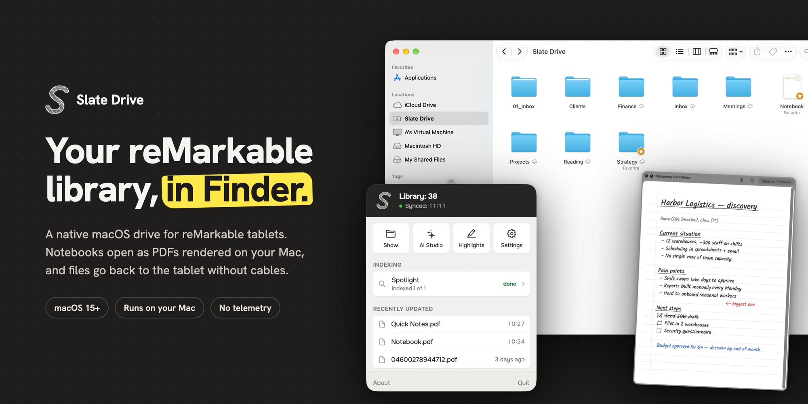

# Slate Drive

Slate Drive shows your reMarkable cloud library in Finder, as a volume under *Locations*. Notebooks open as PDFs rendered on your Mac. The folders match what you see on the tablet. You can send files back without cables or manual exports.

The app is free. There are no ads and no sign-up. The only account involved is your reMarkable one.

**[Download the latest release](https://github.com/altessa-s/slatedrive/releases/latest)** · free · macOS 15+ · notarised installer package

> [!NOTE]
> Slate Drive is MIT-licensed. Right now this repository has builds only. The source code will be published here by the end of 2026. See [Source code and license](#source-code-and-license).

## Contents

- [Getting started](#getting-started)
- [Features](#features)
- [Privacy](#privacy)
- [Updates](#updates)
- [Uninstalling](#uninstalling)
- [Reporting issues](#reporting-issues)
- [Source code and license](#source-code-and-license)

## Getting started

### Requirements

- macOS 15 or later
- A reMarkable account with a paired tablet

Connect isn't required. Without it, reMarkable's free plan applies: by reMarkable's own terms, a file you haven't edited in 50 days stops syncing to desktop apps, so the library in Finder may be incomplete.

### Install

1. Download the installer package (`.pkg`) from [Releases](https://github.com/altessa-s/slatedrive/releases).
2. Open it and follow the installer. It puts Slate Drive in `Applications` and opens it. If an older copy is running, the installer quits it first.
3. The first launch starts a short tour. It connects your account using the one-time code from your reMarkable account website. It also offers launch at login and notifications, and explains why you might want each one. In a beta build, the tour opens with the beta notice.

You can reopen the tour later with **Show the tour** in the About window.

> [!IMPORTANT]
> Keep one copy of the app on your Mac, the one in `Applications`. The Finder volume comes from a File Provider extension, and macOS ties it to one specific app bundle. A second copy lying around, say in `Downloads` or on an old beta 1 disk image that is still mounted, can take the volume away from the copy you use.

## Features

### Library in Finder

The library appears as **Slate Drive** under *Locations*, with the same folders and documents as on the tablet.

Notebooks and annotated documents open as PDFs rendered locally. PDF and EPUB files are passed through as they are. Documents download when you open them, and the folder tree syncs in the background. Favorites and the tablet's trash show up in the volume too.

The app's panel shows sync status and opens the volume in Finder, AI Studio, Highlights and Settings. See [Running in the background](#running-in-the-background) for how the app stays running.

### Your account

Settings › General shows your plan, with your account's email under it; the menu-bar panel shows the email too. An organisation's plan shows as *Connect (Enterprise)*. One account is connected at a time. Disconnecting takes the volume out of Finder and erases that account's data on this Mac before another account can connect.

### Read-only or editing

The volume starts read-only. You can browse and open files, but nothing in the library changes.

Turn on editing and Finder works like a normal disk. You can create folders, upload files, rename, move, and put things in the tablet's trash. Finder only offers operations the app fully supports.

### Send to the tablet

There are four ways to send, and none of them needs the app window:

- **Share menu.** "Save to Slate Drive" appears in every Mac app that has a Share menu: Preview, Mail, Safari, Chrome, your editor.
- **Drag and drop.** Drop files onto the Dock icon (when it's shown) or onto the app in Finder. Nothing opens and nothing asks for confirmation. The menu-bar icon doesn't take files.
- **Shelf.** A panel at the edge of the screen where you can collect files during the day and then send them all with one click. Each file shows what will happen to it: *keep as is*, *→ PDF* or *→ Notebook*.
- **⌘P.** Any app that can print can send to the tablet (see [Print to the tablet](#print-to-the-tablet)).

**What happens to a file.** PDF and EPUB go through unchanged. Word, Pages, HTML, Markdown, RTF, plain text and images (JPG, PNG, HEIC) become either a PDF or a notebook. A PDF is laid out for your tablet's screen: reMarkable 2, Paper Pure, Paper Pro or Paper Pro Move. A notebook is the tablet's own `.rm` format, so you can keep editing it on the device. A typed notebook can't hold tables or images; a file with those goes as a PDF, and the panel tells you so.

**Where it lands.** Files go to a destination folder you set once. Until you set one, the app creates an *Inbox* folder at the top of the library. You can also have it ask for a folder on every send. Tags from the Tablet settings are added to everything you send.

#### Web articles, cleaned up on your Mac

Share a page from Safari, Chrome, Arc or Firefox and it arrives as a PDF laid out for your tablet. You don't need a browser extension, because the Share menu is part of macOS.

Before the PDF is made, the app keeps only the article: text, headings and images. Menus, ads, cookie banners, subscription pop-ups and comments are left out. The cleanup is done by [Defuddle](https://github.com/kepano/defuddle) (the default) or [Readability](https://github.com/mozilla/readability). Both are built in and neither goes online.

You have a few other options:
- clean up with an AI model on your own key (off until you turn it on)
- turn cleanup off and keep the whole page
- drop the page's images

Articles can have their own tag list. If you leave it empty, they get the general tags.

#### Handwritten notebooks

Text sent as a notebook can arrive typed, or written out in pen strokes as if by hand. Handwriting uses the same settings a page has on the tablet itself:

| Setting | Options |
|---|---|
| Tool | Ballpoint, fineliner, pencil, mechanical pencil |
| Thickness | Thin, regular, thick (each tool has its own values, as on the tablet) |
| Smoothing | Slight, medium, full |
| Paper | Blank, lines, grid, dots, margin, US College, Legal |
| Line spacing | Wide, regular, tight |

Each tool leaves its own mark. Ballpoint and pencil vary in pressure along a stroke, while the fineliner holds a steady line. *Slight* smoothing keeps the tremor of a real hand; *full* comes out almost ruler-straight. The template travels with the note, so on the device it looks like a page you started there. On ruled paper the writing sits on the rules, so the spacing setting only matters on a blank page.

### Tags

Off by default; turn it on in the Drive settings. Tablet tags then show up as Finder tags. In editing mode, a tag you change in Finder is written back to the tablet. Colours stay on the Mac because the tablet doesn't have them.

### Keep offline

Pin a folder or a document and Slate Drive keeps a copy on the Mac, so it opens without a network. Unpin it when you no longer need the copy.

### Local backup

The optional backup keeps a continuous copy of the library in a folder you choose. It holds readable PDFs of notebooks and annotated documents, with the tablet's own files next to them. After the first full pass, only changed documents are updated. That works well with Time Machine or any tool that watches a folder.

A backup folder belongs to the account that made it. A folder with another account's backup is left alone. Disconnecting turns the backup off and leaves the copy where it is.

### Search and recognition

Spotlight can index document text, so you can find notes by what's in them, not just by title. Handwriting and printed pages each get their own default engine. Engines you switch off disappear from the menus.

| Engine | Where it runs |
|---|---|
| Apple Vision | On this Mac |
| Tesseract | On this Mac. Uses language data from a folder you choose, and stays off until you choose one |
| Google Cloud Vision | Cloud, with your API key |
| Yandex Vision OCR | Cloud, with a Yandex Cloud API key. Handwriting in Russian and English, print in about four dozen languages |
| MyScript | Cloud, with your MyScript keys. Handwriting only, read from the notebook's pen strokes rather than a picture of the page |
| AI connection | Apple Intelligence on this Mac, or Anthropic, OpenAI, Gemini, DeepSeek or Yandex AI Studio |

Cloud engines stay off until you switch them on, and switching one on asks first: page images will leave this Mac (for MyScript, the pen strokes). The same switch turns it off.

Which engine reads best depends on your language, your hand and the page. I don't quote accuracy numbers, because they'd be measured on somebody else's handwriting. Try two engines on a note you know well and compare.

Markdown you write with the pen counts, whichever engine reads the page: `#` headings, `**bold**`, `*italic*` and `~~struck out~~` become formatting. Text typed on the tablet keeps its place among the handwritten lines.

Text that was read is kept and reused where it fits:
- It is stored with the document. Spotlight, AI Studio, integrations, Shortcuts and MCP reuse a compatible reading instead of paying for a new one. Highlights read their passages separately, and only when needed.
- A page is read again when the document changes, when you pick a different engine, or when an action needs a reading the stored one can't give.
- PDFs that already have a text layer use that layer, and blank notebook pages are skipped.
- If a model refuses a document, that document is flagged and the rest of the pass carries on. You can then give it to a fallback model or read it locally.

### Highlights

The **Highlights** window collects every passage you marked with the highlighter, document by document. Each passage is a picture cut from its page. You can copy or share it, have it recognised, or hide it.

You can also remove a highlight from the tablet, or all highlights of a document. The app asks first and keeps the pages as they were on this Mac.

Highlights show up elsewhere too: an AI Studio action can export them, a rule can start on new highlights, and MCP clients can list and remove them.

### AI Studio

AI Studio is the window where pages turn into transcripts, summaries and exports.

**Actions** work on the documents you select. An action can read the pages, run a model with a prompt, and write a file; the first two steps are optional. The app ships with four actions: Transcribe, Summary, Highlights and Highlights as Images. Export to Word, Export to Markdown and Highlights to Markdown are added as your own actions, so you can edit or delete them.

Output formats:
- PDF, searchable PDF, notebook
- Markdown, Word, RTF, plain text
- the original document, or page images
- highlighted passages. These include highlights the tablet copied from a PDF's text, and marker strokes drawn over handwriting.

**Highlights as Images** cuts each marked passage out of its page and writes them into a PDF, a Word file, PNG images or a Markdown note. It uses no model and costs nothing.

**Transcription settings** belong to each action, with one tab for handwriting and one for printed pages. They cover checkboxes, Markdown written by hand, struck-through text, tables, drawings and spelling repair. When a plain OCR engine reads the page and no prompt follows, *Use AI to normalize* can have a model of your choice tidy up its text.

**Markdown keeps drawings.** A Markdown file comes with its pictures in a folder beside it. Obsidian, and Logseq through a graph folder, get them as attachments.

**Local folders keep what's there.** When a file of the same name already exists, the new one is saved beside it with a number. Turn on **Replace a file of the same name** on the action to overwrite it instead.

**Prompts** are yours to write: one for lectures, one for meetings, one for papers. Each prompt has a name, a description, tags, and a list of the AI connections it may use. Three prompts come with the app, and you can duplicate them as a starting point. Actions refer to a prompt instead of carrying their own wording.

**Rules** run on their own, as *When → If → Do*:
- **When** a document is new, new or changed, given a tag, or highlighted anew.
- **If** it meets your conditions: folder, tag, name, type, favourite, dates, highlight colours. Conditions can be combined with *all*, *any* or *none*, and grouped.
- **Do** a chain of steps: run actions, add or remove tags, add to or remove from favourites, move to a folder, move to the trash.

A rule with only library steps costs nothing. A rule that runs actions has a monthly budget in US dollars; when it hits the budget, it pauses until the first of the next month. If a step fails, **Retry** in the journal picks up from that step. Tags changed in Finder don't start rules yet; use **Process now** for those. In AI Studio, only rules run in the background.

**Journal** logs every run with its tokens and cost, one row per step of a rule. When an engine read the page as an image, the entry also shows how confident it was. You can select rows and copy them.

**Processors** (OCR engines, Compose, writers) are configured in the same window. A processor you switch off isn't offered in any action.

You can also run actions, or send to an integration, straight from Finder. Progress stays on screen until you close it.

### Integrations

Results can go to note-taking apps. Export is one-way; nothing syncs back.

| Integration | What it creates |
|---|---|
| Obsidian | Markdown and attachments in a vault on this Mac |
| Logseq | Files in a graph folder, or entries through Logseq's local API for a database graph |
| Bear | New notes, via Bear's URL scheme |
| Apple Notes | Notes in a folder of the default account |
| Zotero | Items and attachments, through Zotero on this Mac |
| DEVONthink | Records in the database and group you choose |
| Readwise | Book highlights, on Readwise's servers |
| Readwise Reader | Saved documents |

- **Setup:** each integration has its own setup form, and secrets are stored in the Keychain.
- **Naming:** when an integration creates its own folder or namespace, it's called "reMarkable (Slate Drive)". You can rename it on the form.
- **Tags:** notes that support tags get `reMarkable` first, then whatever tags you add on the form.
- **Sending again:** depending on the app and your settings, a second send either updates the note or creates a new one.

### Sync across Macs

Macs signed in to the same Apple account and the same reMarkable account share their setup through iCloud. There is nothing to switch on.

What syncs:
- AI connections, except ones that run on this Mac or on your local network
- recognition and sending settings, including which cloud engines are on. Your consent to send pages travels with the switch, so another Mac won't ask again
- recognised text, so another Mac can reuse a reading instead of paying for it again
- highlight scans, and the passages you hid

API keys go to iCloud Keychain. The reMarkable sign-in, MCP tokens, integrations, local folders, your own prompts and actions, and the Spotlight index stay on each Mac. Documents always come from the reMarkable cloud.

### Shortcuts, Spotlight and Siri

Shortcuts can find documents by name, tag, kind, folder or date, get a document's file or its text, and open it. Getting text may run the recognition engine you set up. With editing on, Shortcuts can also tag, move, rename, favourite and trash documents, and create folders. Opening and getting a document are available from Spotlight and Siri too.

### MCP server

Slate Drive can run a local Model Context Protocol server. It's off by default and listens on localhost only.

Each client gets its own named token, with the permissions you pick:
- Read library
- Read text and recognition
- Read highlights
- Export files
- Page images
- Edit library
- Move to trash
- Remove highlights

The token is shown once, when you make it, with the Claude Code command and the `.mcp.json` snippet ready to copy. The Keychain keeps only a fingerprint of it. You can edit a token's permissions or revoke it at any time. If you used MCP in beta 1, your token keeps working as one named "Default".

Clients like Claude Desktop or Claude Code can:
- list the library
- read document text
- search recognised content
- get a short-lived link to a file
- list a document's highlights
- move items to the trash
- remove highlights from the tablet

The last two need the token's permission, and the app asks you to confirm where the client supports it.

A client only sees the tools its token allows. Changes to the library also need editing turned on. Nothing is exposed to the internet, so cloud-hosted connectors can't reach the server. What a client does with the content it reads is up to that client, so give tokens only to clients you trust.

### Print to the tablet

The virtual printer is optional and off by default. Add it in *Printers & Scanners*, and any Mac app can print into a folder on the tablet.

- By default only this Mac sees the printer. Share it on the local network and iPhones and iPads in the house can print to the tablet too, as long as the Mac is awake.
- It accepts PDF and Apple Raster.
- Paper sizes include tablet sizes, A4 and Letter.
- A finished print is sent straight away, and you get a notification.

### Running in the background

The app lives in the menu bar. The menu-bar icon and the Dock icon are both optional.

Launch at login uses a small helper. It starts the app at login, when Finder needs it, and after a crash. With launch at login on:
- **Close Slate Drive** closes the windows, and syncing carries on.
- **Quit** (⌘Q) stops the app until you open it again or log in again.

### Notifications

Every kind of banner has its own switch on the **Notifications** page in Settings. They all start on:
- a send that arrived, or one that didn't
- a change Finder couldn't make
- sync problems
- AI Studio runs
- a rule that hit its budget
- a send to a note app

### Languages

The interface is available in American English, German, Spanish, French, Dutch and Russian.

## Privacy

There are no analytics and no telemetry. The app runs in the App Sandbox. Tokens and API keys are stored in the Keychain and never in plain settings files or logs.

What leaves your Mac depends on the engine or model you chose and what it reads:
- **A cloud OCR engine** you switched on gets page images. MyScript gets a notebook's pen strokes instead.
- **An AI action** sends its model page images or text, depending on the connection. Apple Intelligence's on-device model sends nothing. Actions without a model, and rules made only of library steps, send nothing to an AI provider.
- **Use AI to normalize** sends an engine's text to the model you picked.
- **Readwise and Readwise Reader** get the text you send them.
- **MCP clients** you gave a token to get what its permissions allow.

Each of these says so at the place where you switch it on.

Shared web pages are loaded from the website, like in a browser. Defuddle and Readability clean them up on your Mac and send nothing to an AI provider. With AI cleanup on, the model gets the article's text, title and address. The finished PDF goes to the reMarkable cloud like any other send.

Settings, AI connections, recognised text and highlight scans sync between your Macs through your own iCloud account, and API keys through iCloud Keychain. MCP tokens stay on the Mac where you made them.

- [Privacy Policy](https://slatedrive.app/privacy)
- [Terms of Use](https://slatedrive.app/terms)

## Updates

Updates come from [GitHub Releases](https://github.com/altessa-s/slatedrive/releases). You can check by hand with **Check now** under Settings › General (or **Check for Updates…** in the app menu when the Dock icon is shown), or let the app check on its own. It can download an update in the background, but it only installs when you say so. After an update, a **What's New** window shows the notes once.

On beta 1, check for updates the same way, or install the `.pkg` from the release page. Before you do, read the [beta 2 release notes](https://github.com/altessa-s/slatedrive/releases/tag/v1.0.0-beta-173134fb):
- cloud recognition and AI Studio results made by beta 1 are made again once, when first needed. Those are normal paid requests to your provider.
- rules made in beta 2 don't work if you go back to beta 1.

## Uninstalling

Use **Uninstall…** under Settings › General, or **Uninstall Slate Drive…** in the app menu when the Dock icon is shown. It takes the drive out of Finder, removes the background helper, and moves the app to the Trash. If macOS doesn't let it, the app shows itself in Finder for you to drag to the Trash after it quits. You choose whether to sign this Mac out or stay signed in.

Changes that hadn't synced are kept by macOS, and the app shows you where. Your backup folder, AI Studio output folders and documents in the cloud are kept. If you want, the app's local data (AI Studio files, logs, caches, the index) can go to the Trash too, where you can still put it back.

## Reporting issues

[Open an issue](https://github.com/altessa-s/slatedrive/issues/new/choose) and include:

- the version line from the About window (it has the commit the build came from)
- your macOS version
- what you did and what happened

## Source code and license

Slate Drive is released under the [MIT License](LICENSE).

The source isn't here yet. I plan to publish it in this repository by the end of 2026. Until then, the repository hosts releases, the issue tracker and this README.

---

Defuddle, Readability and Tesseract are third-party open-source components and run on your Mac.

Slate Drive is independent. It is not affiliated with, endorsed, or sponsored by reMarkable AS. reMarkable is a trademark of reMarkable AS.
